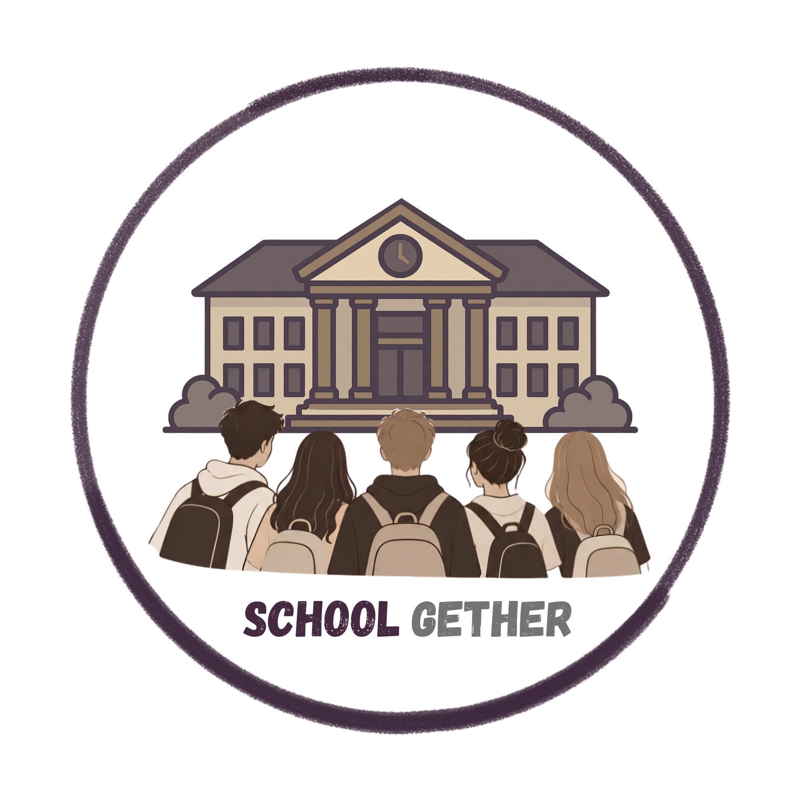

  

<h1 align="center">SchoolGether</h1>

Aprende. Partilha. Cresce.

  <strong><a href="https://schoolgether-pap.github.io/SchoolGether/">Visitar o site do SchoolGether</a></strong>

## Sobre a SaguiLearn

A **SaguiLearn** é a empresa concebida no âmbito deste projeto para desenvolver soluções digitais de apoio à educação. O seu objetivo é facilitar o trabalho da comunidade escolar e melhorar a organização e o acesso à aprendizagem.

O **SchoolGether** é a plataforma educativa desenvolvida pela SaguiLearn, destinada a instituições de ensino, professores e alunos. O projeto pretende reunir ferramentas de gestão escolar e recursos de apoio ao ensino e à aprendizagem num ambiente simples de utilizar.

## Conhecer o projeto

- **[Aceder à demonstração online](https://schoolgether-pap.github.io/SchoolGether/)** — conhecer a plataforma e consultar os planos de demonstração.
- **[Consultar o desenvolvimento](https://github.com/Schoolgether-PAP/SchoolGether/tree/develop)** — código e documentação técnica no ramo `develop`.
- **[Ver as alterações em revisão](https://github.com/Schoolgether-PAP/SchoolGether/pulls)** — acompanhar as próximas entregas.

## Contexto académico

Projeto desenvolvido por uma equipa de três alunos do **12.º ano de Informática de Gestão da Escola Profissional de Salvaterra de Magos**, no âmbito da **Prova de Aptidão Profissional (PAP)**.

A plataforma encontra-se em desenvolvimento. Os planos apresentados são fictícios e destinam-se à demonstração académica, sem cobranças reais.
