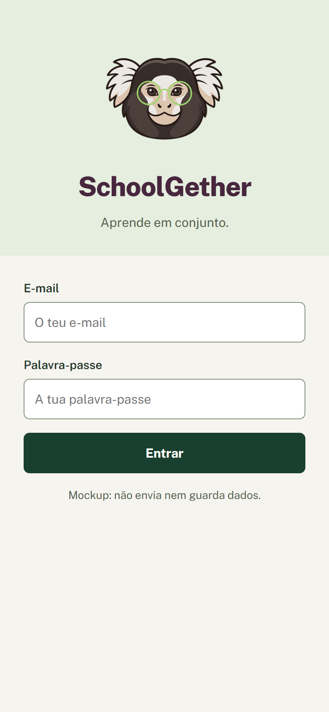
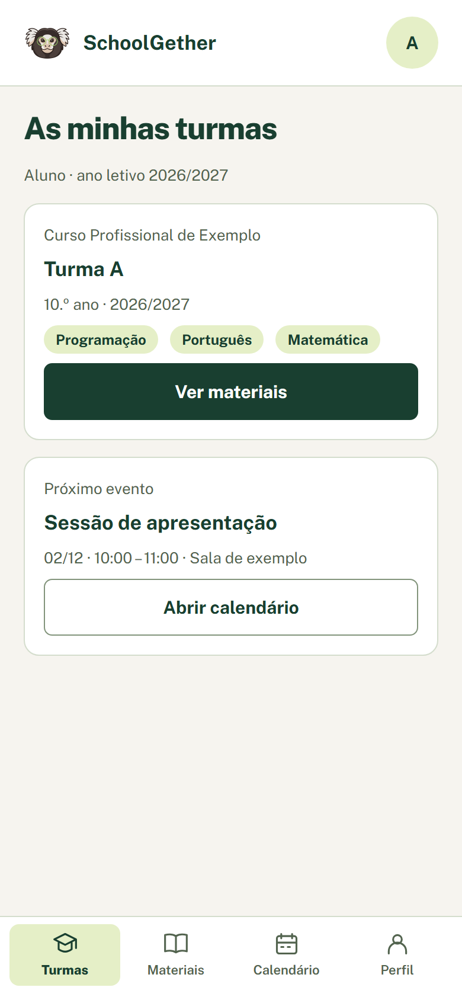
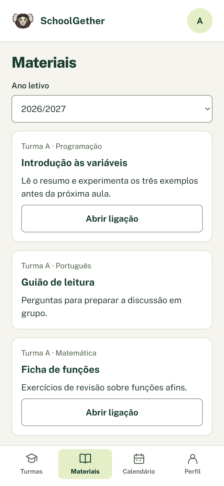
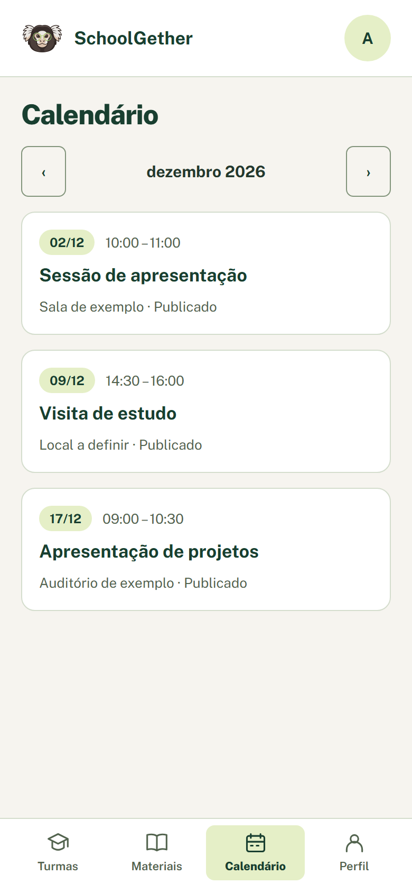
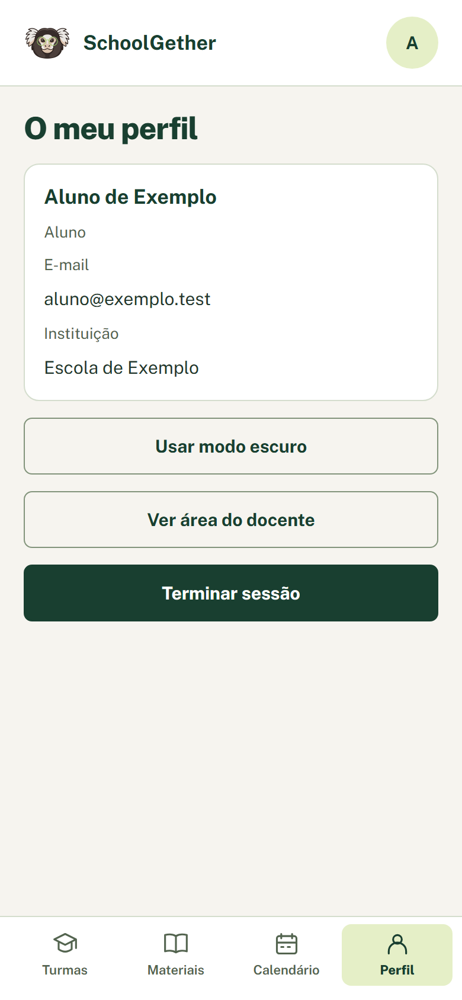
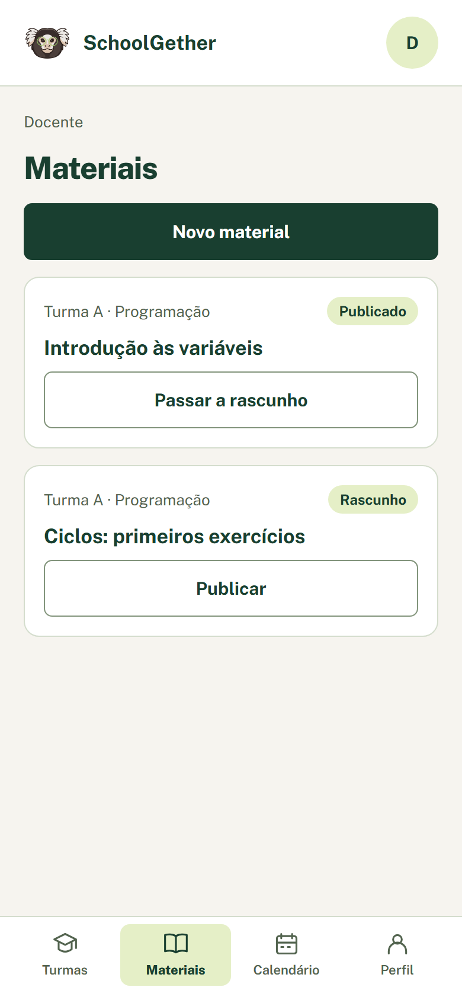

# Mockup da app SchoolGether

Protótipo visual de uma app móvel (390×844), feito a partir da identidade do site. **Não é código da app MAUI** e não liga à API.

Para ver: descarregar `index.html` e abri-lo num navegador (o GitHub só mostra o código-fonte).

Ecrãs: Entrar, As minhas turmas, Materiais (aluno), Calendário, O meu perfil e Materiais (docente). Os dados são fictícios; nada é enviado nem guardado. O tipo de letra Public Sans é carregado do Google Fonts.

## Imagens

Exportadas de `index.html` (780×1688, modo claro).

